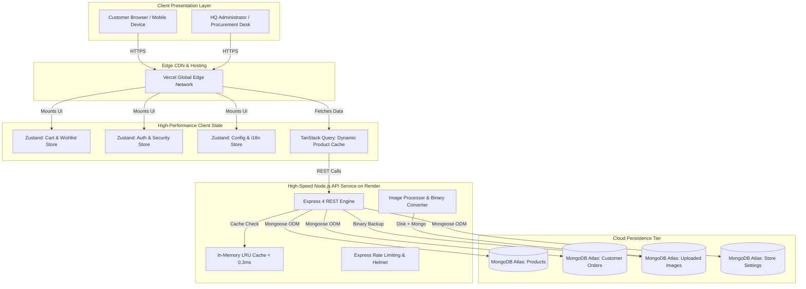
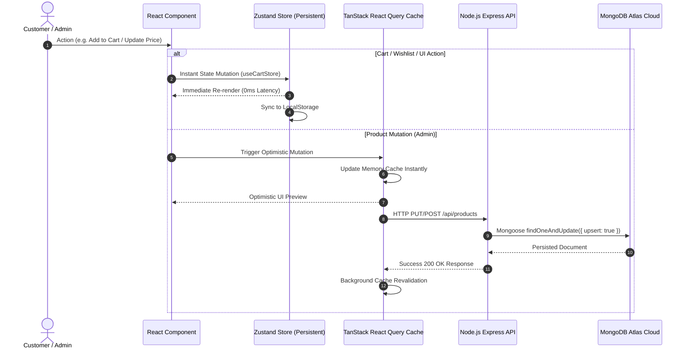

# 📚 OMEGA Writing Notebooks & Stationery

[](https://react.dev/)
[](https://www.typescriptlang.org/)
[](https://vitejs.dev/)
[](https://tailwindcss.com/)
[](https://tanstack.com/query)
[](https://zustand-demo.pmnd.rs/)
[](https://nodejs.org/)
[](https://www.mongodb.com/atlas)
[](https://omegastationery.vercel.app)
[](https://omega-stationery-backend.onrender.com)

> **Tanzania's Benchmark in School Counter Books, Exercise Books & Institutional Stationery since 1998.**  
> Manufactured at Soweto SIDO Viwandani, Mbeya, Tanzania with fast nationwide delivery and direct WhatsApp procurement.

---

## 🌟 Live Applications & Portals

| Service | Environment | Live URL | Description |
| :--- | :--- | :--- | :--- |
| **Storefront (Vercel)** | Production | [omegastationery.vercel.app](https://omegastationery.vercel.app) | Public E-Commerce Storefront, Wholesale Portal & School Tenders |
| **Admin ERP Portal** | Production | [omegastationery.vercel.app/omega-hq-portal-2026](https://omegastationery.vercel.app/omega-hq-portal-2026) | Direct MongoDB Product Catalog, Image Studio, Orders & CMS |
| **API Backend (Render)** | Cloud Node.js | [omega-stationery-backend.onrender.com](https://omega-stationery-backend.onrender.com) | Express + Mongoose API with Sub-millisecond In-Memory LRU Cache |
| **Health Telemetry** | Diagnostics | [/api/health](https://omega-stationery-backend.onrender.com/api/health) | Real-time database status, edge cache hit ratio & latency stats |

---

## 🏗️ System Architecture & Data Flow



---

## ⚡ 10x Performance Upgrade: Zustand + TanStack Query



---

## 🏛️ Clean Architecture & Folder Structure

The codebase is organized following **Domain-Driven Modular Clean Architecture**, separating business rules, application orchestration, external infrastructure, and UI presentation:

```
c:\Users\Admin\Documents\GitHub\OMEGA-Stationery/
├── public/                                # Static public assets & catalog media
│   ├── omega-products/                    # Official product photographs & ream shots
│   └── uploads/                           # Local uploaded product images cache
│
├── server/                                # High-Performance Pure Node.js Backend
│   ├── server.mjs                         # Express API, Mongoose models & Edge LRU cache
│   ├── package.json                       # Backend dependencies (express, mongoose, cors, helmet)
│   └── .env                               # Server environment variables & MongoDB connection
│
├── src/                                   # Frontend TypeScript Source Root
│   │
│   ├── domain/                            # Enterprise Business Rules & Models
│   │   ├── types.ts                       # Core product, cart, order, and user interfaces
│   │   ├── admin/                         # Admin validation schemas (Zod)
│   │   │   └── adminSchemas.ts            # Category, stock, and price validation
│   │   └── products/                      # Domain catalog constants & metadata
│   │       └── products.data.ts           # Product catalog baseline definitions
│   │
│   ├── application/                       # State Orchestration & Application Services
│   │   ├── state/                         # High-Speed Persistent Zustand Stores
│   │   │   ├── useCartStore.ts            # Cart items, quantities, and persistent wishlist
│   │   │   ├── useAuthStore.ts            # User clearance, sessions, and authentication
│   │   │   └── useConfigStore.ts          # Store branding, WhatsApp numbers & i18n
│   │   ├── hooks/                         # React Query Hooks & Custom Hooks
│   │   │   └── useProductsQuery.ts        # TanStack Query product hooks with optimistic updates
│   │   └── common/                        # Common context bridges
│   │       └── context/StoreContext.tsx   # React Query + Zustand unified StoreProvider
│   │
│   ├── infrastructure/                    # External Interfaces & Network Clients
│   │   └── api/                           # HTTP REST client with auto-fallback
│   │       └── api.ts                     # Robust fetch client with smart local/cloud resolution
│   │
│   ├── presentation/                      # UI Components, Features & Layouts
│   │   ├── common/                        # Shared UI components across features
│   │   │   ├── layout/                    # Master layout, Navbar, Footer, MegaMenu
│   │   │   │   ├── navbar/                # MegaMenu, SearchOverlay, MobileNavigation
│   │   │   │   └── Layout.tsx             # Root layout shell
│   │   │   ├── feedback/                  # Toast notifications & alert banners
│   │   │   └── routing/                   # ProtectedRoute, AdminRoute & RouteLoader
│   │   │
│   │   └── features/                      # Domain Feature Modules
│   │       ├── admin/                     # Admin ERP Portal Feature
│   │       │   ├── pages/AdminDashboardPage.tsx
│   │       │   └── components/            # ImageEditorModal, ProductForms, Analytics
│   │       ├── cart/                      # Cart & Checkout Module
│   │       │   ├── pages/CartAndCheckoutPage.tsx
│   │       │   └── components/            # CartItemList, CheckoutForm, CartEmptyState
│   │       ├── products/                  # Catalog & Product Showcase Module
│   │       │   ├── pages/CatalogPage.tsx
│   │       │   ├── pages/ProductDetailsPage.tsx
│   │       │   └── components/            # CatalogHero, CatalogToolbar, Notebook3D
│   │       ├── wholesale/                 # B2B Wholesale & Tenders Module
│   │       │   ├── pages/WholesalePage.tsx
│   │       │   ├── pages/SchoolTendersPage.tsx
│   │       │   └── components/            # VolumeTiers, WholesaleCalculator, LogisticsStrip
│   │       ├── marketing/                 # Marketing & Editorial Module
│   │       │   ├── pages/HomePage.tsx     # Hero graphic animation, features, showcase
│   │       │   ├── pages/AboutPage.tsx    # Factory story, brand heritage since 1998
│   │       │   └── pages/ContactPage.tsx  # Branch hotlines (Mbeya, Mwanza, Dar es Salaam)
│   │       ├── auth/                      # Authentication Module
│   │       │   └── pages/                 # LoginPage, RegisterPage, AccountPage
│   │       └── wishlist/                  # Wishlist Module
│   │           └── pages/WishlistPage.tsx
│   │
│   ├── App.tsx                            # React Router tree with lazy-loaded features
│   ├── main.tsx                           # Application entry point with QueryClientProvider
│   └── index.css                          # Custom styles, animations & design tokens
│
├── render.yaml                            # Cloud Render Infrastructure as Code (Blueprint)
└── RENDER_DEPLOY_GUIDE.md                 # Step-by-step cloud deployment walkthrough
```

---

## 🚀 Key Features Breakdown

### 1. 🛍️ E-Commerce & Direct WhatsApp Ordering
- **Real-Time Tanzanian Shilling (TZS)** pricing with wholesale carton tiers and single-unit retail options.
- **Cart & Wishlist Engine**: Built with Zustand for instantaneous sub-millisecond updates across all devices.
- **Direct WhatsApp Procurement**: One-click order dispatch to 4 official OMEGA dispatch desks:
  - **Mbeya Branch (Soweto SIDO)**: `+255 746 268 391`
  - **Dar es Salaam Hotline**: `+255 715 268 391`
  - **Executive Desk**: `+255 624 265 480`
  - **Mwanza Branch Desk**: `+255 699 032 777`

### 2. 📦 B2B Wholesale & School Tenders Portal
- **Interactive Carton Calculator**: Calculate carton quantities, bulk discounts (10%–20%), total tonnage, and freight estimates.
- **Institutional School Tender Requisitions**: Tailored requisition sheets for primary and secondary schools across Tanzania, computing reams, counter books, and examination pads.

### 3. 🎨 OMEGA Product Studio (Built-in Image Editor)
- **100% Responsive on all screen sizes** (iPhone, Android, Tablets, Laptops & Ultra-Wide monitors).
- **Interactive Cropper**: Aspect ratio presets (`1:1 Square`, `4:5 Portrait`, `16:9 Banner`, `Freeform`).
- **Studio Pedestal & Backgrounds**: Transparent alpha-channel canvas, studio pedestal gradient, and custom RGB color pickers.
- **Photo Adjustments & Instagram Filters**: Brightness, contrast, saturation, sharpness, warm tones, and monochrome presets.
- **Dual Cloud Persistence**: Saved to local disk cache **plus MongoDB Atlas binary storage (`UploadedImageModel`)** for zero-loss container restarts.

### 4. ⚡ High-Speed Node.js + MongoDB Atlas Backend
- Pure Node.js Express architecture (`server/server.mjs`) — zero Java dependencies.
- **Sub-Millisecond In-Memory LRU Cache**: Edge response caching for `/api/products` and `/api/config` with sub-0.3ms latency.
- **MongoDB Atlas Cloud Connection**: 44 official OMEGA products with automated fallback to local cache during connectivity interruptions.
- **Auto-Seeding & Resilience**: Health check endpoint `/api/health` continuously reporting database status and cache hit ratios.

### 5. 🌍 Dual-Language Internationalization (English & Swahili)
- Seamless one-click switch between **English** and **Kiswahili** (`sw`).
- All product descriptions, specifications, page headers, announcements, and navigation menus are fully bilingual.

---

## 🛠️ API Endpoints Reference

All endpoints are hosted at `https://omega-stationery-backend.onrender.com` (or `http://localhost:5000` locally):

| Method | Endpoint | Description |
| :--- | :--- | :--- |
| `GET` | `/api/health` | Service health, MongoDB status, uptime & cache hit ratio |
| `GET` | `/api/products` | Fetch all products (supports `?category=`, `?search=`, `?featured=`) |
| `GET` | `/api/products/:id` | Fetch single product by ID or MongoDB `_id` |
| `POST` | `/api/products` | Create / upsert a new product into MongoDB Atlas |
| `PUT` | `/api/products/:id` | Update master product details in MongoDB Atlas |
| `PATCH`| `/api/products/:id/price` | Fast inline price & discount update |
| `PATCH`| `/api/products/:id/stock` | Fast stock status & quantity toggle |
| `DELETE`| `/api/products/:id` | Delete product from database |
| `POST` | `/api/upload` | Direct Base64 / multipart image upload to disk & MongoDB |
| `GET` | `/uploads/:filename` | Serve uploaded product image with immutable cache headers |
| `GET` | `/api/config` | Retrieve live store branding, phone numbers & company profile |
| `PUT` | `/api/config` | Update store configuration & CMS text |
| `GET` | `/api/orders` | Retrieve customer procurement orders |
| `POST` | `/api/orders` | Submit new customer procurement order |
| `GET` | `/api/cache/stats` | In-memory edge cache diagnostics & telemetry |
| `POST` | `/api/cache/flush` | Invalidate all server-side edge caches |

---

## 💻 Getting Started Locally

### Prerequisites
- [Node.js](https://nodejs.org/) (v18.0.0 or higher)
- [npm](https://www.npmjs.com/) (v9.0.0 or higher)

### 1. Clone the Repository
```bash
git clone https://github.com/MrVishalKuriya/OMEGA-Stationery.git
cd OMEGA-Stationery
```

### 2. Install Dependencies
```bash
# Install frontend dependencies
npm install

# Install backend dependencies
cd server
npm install
cd ..
```

### 3. Configure Environment Variables
Frontend (`.env` in root):
```env
VITE_API_URL=https://omega-stationery-backend.onrender.com
VITE_BACKEND_URL=https://omega-stationery-backend.onrender.com
```

Backend (`server/.env`):
```env
PORT=5000
MONGODB_URI=mongodb+srv://<user>:<password>@omega.ccgcbcy.mongodb.net/omega_stationery?retryWrites=true&w=majority
CORS_ALLOWED_ORIGINS=*
```

### 4. Run Development Servers
```bash
# Terminal 1: Start Node.js Express Backend (Port 5000)
npm run server

# Terminal 2: Start Vite React Frontend (Port 3000)
npm run dev
```

Visit `http://localhost:3000` in your browser. The frontend will automatically route API requests to your local backend at `http://localhost:5000`.

---

## 🚢 Production Deployment

### Frontend Deployment (Vercel)
The frontend is configured for zero-config static deployment on Vercel:
1. Connect your GitHub repository to [Vercel](https://vercel.com).
2. Framework Preset: **Vite**.
3. Build Command: `npm run build`.
4. Output Directory: `dist`.
5. Automatic deployments occur on every push to the `main` branch.

### Backend Deployment (Render)
The backend is defined via Render Infrastructure as Code in `render.yaml`:
```yaml
services:
  - type: web
    name: omega-stationery-backend
    runtime: node
    rootDir: server
    buildCommand: npm install
    startCommand: node server.mjs
    plan: free
    region: frankfurt
    envVars:
      - key: PORT
        value: 5000
      - key: MONGODB_URI
        value: <your-mongodb-atlas-uri>
      - key: CORS_ALLOWED_ORIGINS
        value: "*"
    healthCheckPath: /api/health
```

---

## 🛡️ License & Trademarks

- **OMEGA Stationery & Books**: Ubora Unaouaminiwa (Quality You Can Trust).
- Manufactured by **Indigo Printers Ltd**, Soweto SIDO Industrial Estate, Mbeya, Tanzania.
- Codebase licensed under the **MIT License**.
